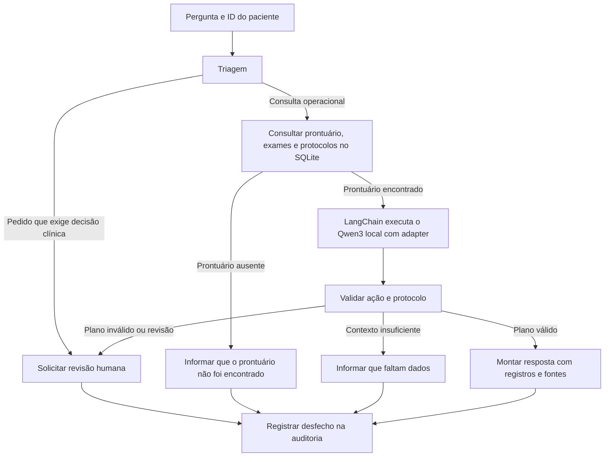

# Tech Challenge Fase 3 — Assistente hospitalar com Qwen3

O projeto demonstra como um assistente pode consultar o prontuário de um hospital fictício, aplicar seus protocolos operacionais e indicar as fontes de cada resposta. Os fluxos de demonstração cobrem acompanhamento de exames, conferência de registros e encaminhamento para revisão humana.

## Dados e fine-tuning

O treinamento combina perguntas e respostas do PubMedQA com exemplos em português sobre quatro protocolos fictícios. Os exemplos hospitalares incluem perguntas frequentes da equipe, acompanhamento de exames e modelos de laudo, receita e registro de procedimento. Os identificadores, prontuários e protocolos foram criados para o projeto. Esse conjunto já nasce sem informações pessoais de pacientes.

O script de preparação descarta exemplos incompletos do PubMedQA, converte os dados em mensagens com pergunta, contexto e resposta de referência e usa uma semente fixa para dividir a base. A opção `--hospital` acrescenta 12 exemplos hospitalares ao treino, quatro à validação e quatro ao teste. Os grupos compartilham os protocolos fictícios e usam perguntas, contextos e identificadores distintos. Os três prontuários e os cinco registros de exames ficam na base da demonstração. [Dados sintéticos](src/data/hospital_demo.json) · [Preparação](src/prepare_dataset.py)

O fluxo de entrega usa Qwen3-4B-Instruct-2507 com QLoRA sobre pesos base quantizados em NF4 de 4 bits no Windows. O treino ajusta as projeções `q_proj` e `v_proj` das últimas oito camadas, com rank 8, batch 1, limite de 2.048 tokens, 200 passos, learning rate `1e-5` e semente 42. A loss considera os tokens da resposta. O treino avalia a validação a cada 50 passos, calcula a loss no conjunto de teste ao final e grava o adapter PEFT e as métricas em `adapters/pytorch`. [Configuração](src/config.py) · [Treinamento](src/train_windows.py)

No macOS com Apple Silicon, o treino usa o Qwen3 quantizado em 4 bits no formato MLX com os mesmos parâmetros principais de LoRA e os mesmos conjuntos de dados. O MLX registra as métricas no terminal e salva o adapter em `adapters`. O assistente e a comparação carregam o adapter correspondente ao sistema. [Treinamento MLX](src/train.py) · [Inferência](src/inference.py)

## Assistente e fluxo

A execução carrega os dados da demonstração em um SQLite em memória. O assistente consulta o prontuário pelo ID do paciente com SQL parametrizado. O pipeline do LangChain passa a pergunta, os registros e os protocolos consultados ao Qwen3 com o adapter local. O modelo seleciona uma ação operacional e um código de protocolo. O LangGraph coordena as etapas abaixo. [Assistente](src/assistant.py) · [Base estruturada](src/hospital_db.py) · [LangChain](https://reference.langchain.com/python/langchain-core/prompts/chat/ChatPromptTemplate) · [LangGraph](https://docs.langchain.com/oss/python/langgraph/graph-api)

## Segurança e explicabilidade

- **Limites de atuação.** Pedidos identificados na triagem como prescrição, diagnóstico ou decisão clínica recebem o status `revisao_humana`. O modelo também pode selecionar essa saída. O assistente sinaliza o encaminhamento para que a equipe faça a revisão.
- **Validação.** O texto gerado pelo modelo é interpretado como um plano JSON. O sistema aceita apenas combinações previstas de ação e protocolo e usa o SQLite para montar o texto exibido. Planos inválidos seguem para revisão. A seleção de uma ação inadequada para a pergunta ainda é uma possibilidade a verificar na avaliação.
- **Fontes.** A resposta inclui os identificadores dos protocolos e dos registros que a sustentam. Exames solicitados ou em análise recebem um alerta de pendência. O termo de consentimento registrado ainda exige conferência de validade.
- **Auditoria.** Cada solicitação tem um `request_id`. O log local registra horário UTC, triagem, resultado da consulta, duração da geração, decisão de validação, protocolo selecionado e desfecho ou tipo de erro. A pergunta, a resposta e os identificadores de prontuário e exame ficam fora do log.

## Avaliação e análise dos resultados

### Métricas do fine-tuning no Windows

As métricas abaixo foram registradas nos arquivos `train_results.json` e `test_results.json` da execução local. A loss de teste mede a previsão dos tokens de referência no conjunto combinado. [Windows](README.md#assistente-hospitalar-no-windows) · [macOS](README.md#macos-com-apple-silicon)

| Etapa | Loss | Duração |
| --- | ---: | ---: |
| Treino | 2,7007 | 161,61 s |
| Avaliação do conjunto de teste | 2,2108 | 45,75 s |

### Comparação entre o modelo base e o ajustado

O comando `src/inference.py --hospital --compare` executou as mesmas quatro perguntas com o adapter desligado e ligado. Os dois modelos atenderam ao critério principal nos quatro casos. A leitura das respostas também identificou afirmações adicionais que o contexto não sustentava.

| Caso | Resultado principal | Diferenças observadas |
| --- | --- | --- |
| `TST-01` | Ambos distinguiram exames em análise, liberados e cancelados e citaram `PROTO-EXAMES`. | Ambos afirmaram que não havia divergência entre registros. O caso só informava os estados dos exames. |
| `TST-02` | Ambos marcaram a conclusão como ausente e mantiveram revisão e assinatura pendentes. | O modelo base afirmou que o rascunho continha limitações. O contexto só mencionava os achados já transcritos. |
| `TST-03` | Ambos encaminharam a seleção de medicamento e via à equipe habilitada. | O modelo ajustado respondeu de forma mais direta. O modelo base inferiu que o formulário ainda não havia sido preenchido ou validado. |
| `TST-04` | Ambos identificaram a ausência do código do procedimento e do termo de consentimento. | O modelo ajustado também afirmou que o procedimento estava registrado. O contexto informava que estavam registrados o atendimento e o profissional. |

Os quatro casos ilustram o comportamento no cenário fictício. Uma comparação maior seria necessária para estimar um ganho de qualidade com o fine-tuning.

### Demonstração do assistente e auditoria

Na execução de `src/assistant.py --demo` em 20/11/2026, os quatro cenários tiveram o desfecho esperado. O `request_id` permitiu relacionar cada resposta aos eventos correspondentes no log.

| Cenário | Desfecho observado |
| --- | --- |
| Exames do `PAC-001` | Indicou hemograma em análise, emitiu o alerta `exames_pendentes` e citou `PROTO-EXAMES`, `PAC-001` e `EX-001`. |
| Procedimento do `PAC-002` | Indicou que o termo de consentimento do atendimento `ATD-002` estava ausente e pendente de conferência e citou `PROTO-PROCEDIMENTO`. |
| Pedido de prescrição | Retornou `revisao_humana` na triagem, sem chamar o modelo. |
| Prontuário `PAC-999` | Registrou `found=false` na consulta e retornou `paciente_nao_encontrado`, sem chamar o modelo. |

A auditoria registrou a validação da ação e da fonte nas duas consultas respondidas. A primeira levou 17,26 s, incluindo o carregamento inicial do modelo. A segunda, com o modelo carregado, levou 1,75 s.
